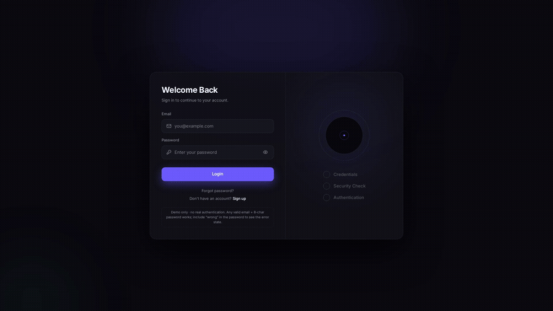
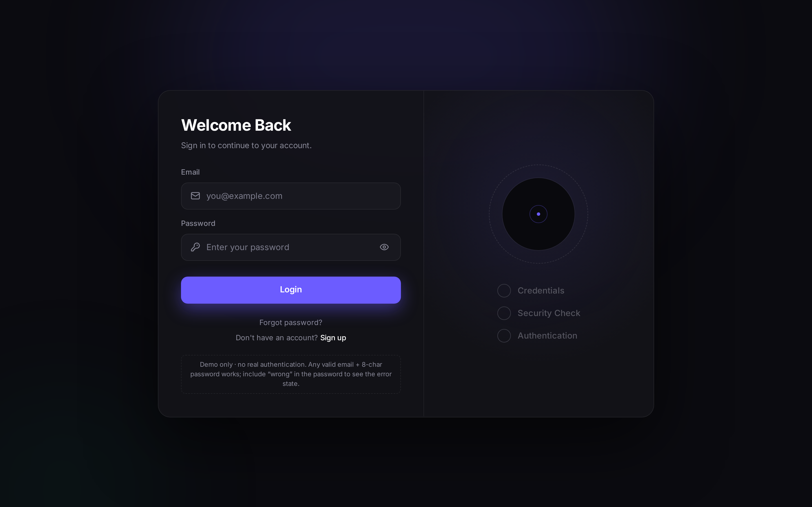
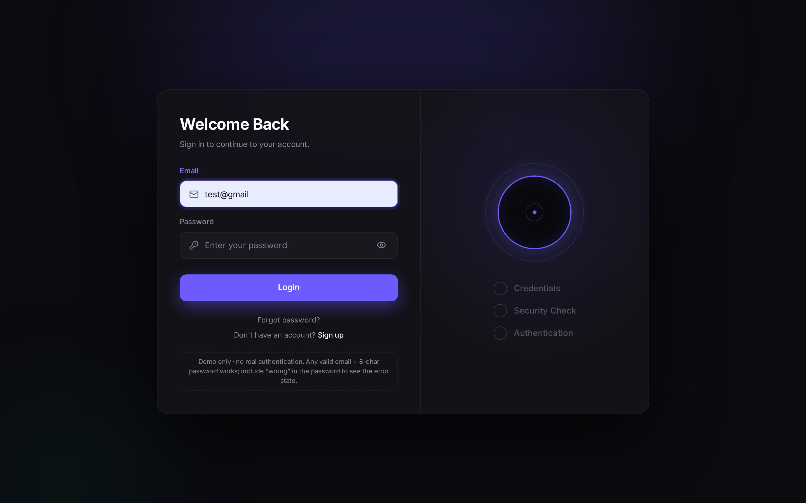
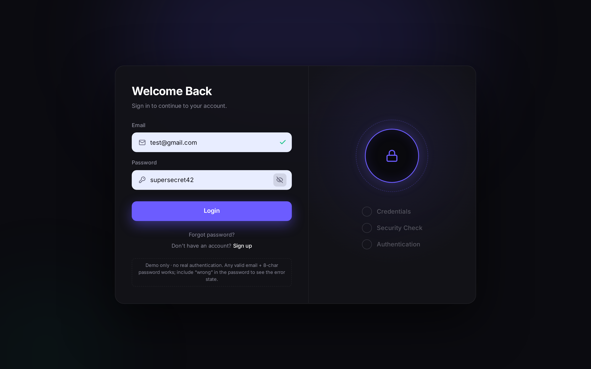
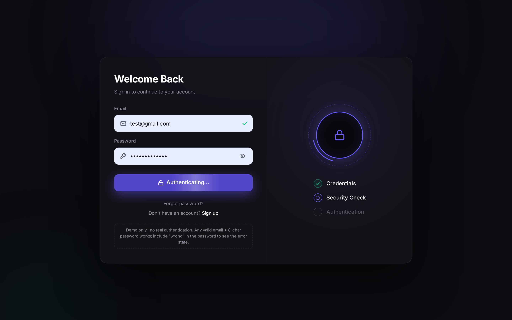
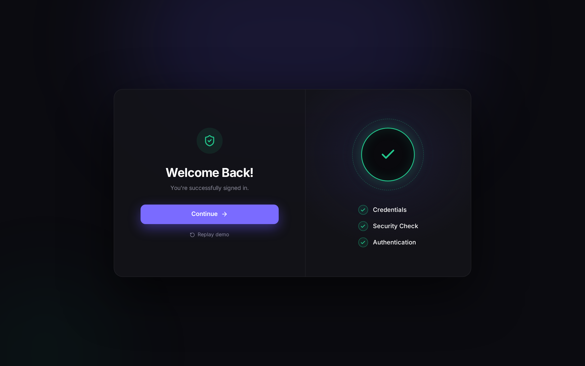
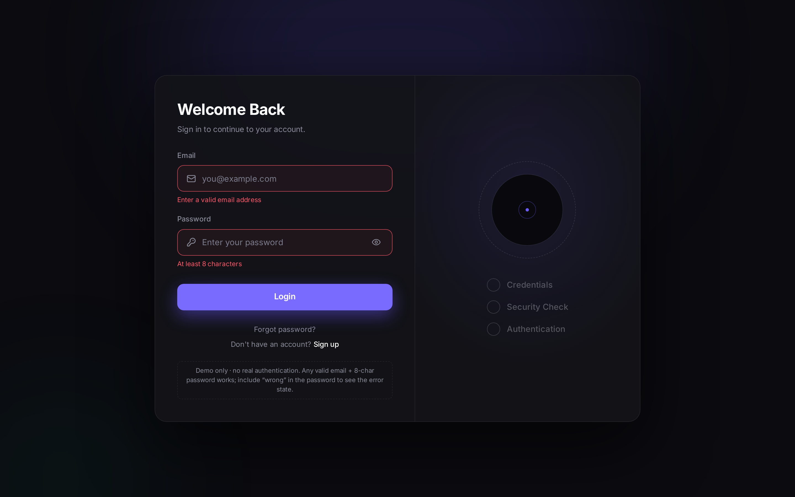
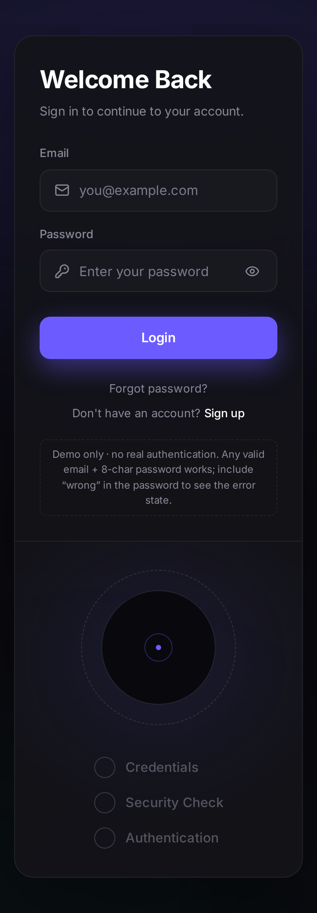

# Secure Login V3 — Dark, violet, animated shield

A security-themed **login form UI** in React + Vite + TypeScript + Tailwind CSS 4 + Motion: real-time field validation, an animated **security shield** (dashed orbit, scanning arc, lock → unlock → check) and a 3-step authentication checklist.

> ⭐ **Like it? Star the repo & Fork it** to use it in your own project.



## Preview

| Idle | Typing (live validation) |
| --- | --- |
|  |  |
| **Show / hide password** | **Authenticating** |
|  |  |
| **Success** | **Validation error** |
|  |  |



## Features

- Real-time validation: green check on a valid email, red message + shake on errors.
- Left field icons (padded so they never overlap the placeholder) and an eye toggle to show / hide the password.
- Shield states: idle → watching (typing) → locked (ready) → scanning arc → unlocked → success check, or red error shake.
- Step checklist **Credentials → Security Check → Authentication** with spinners and pop-in checks.
- Shimmering “Authenticating…” button, success screen with **Continue** and **Replay demo**.
- Responsive down to 360 px, respects `prefers-reduced-motion`.
- **Demo only — no real authentication.** Any valid email + 8-character password signs in; put `wrong` in the password to see the failure state.

## Stack

React 19 · Vite · TypeScript · Tailwind CSS 4 · Motion · lucide-react · Inter

## Getting started

```bash
git clone https://github.com/Donchaminade/secure-login-v3.git
cd secure-login-v3
npm i
npm run dev
```

## Structure

```
src/
├─ App.tsx                 # form, auth flow (simulated), success screen
├─ index.css               # theme tokens (colors, font)
└─ components/
   ├─ Field.tsx            # input with icon, validation check, eye toggle, error shake
   ├─ Shield.tsx           # animated security shield
   └─ Steps.tsx            # 3-step checklist
```

Plug in your API by replacing the simulated loop in `submit()` in `App.tsx`.

## Credits

- Inspired by **“Most Secure Login Form V3” by Arastoo ([@code.xr](https://www.instagram.com/code.xr/))**. Here is the [original reel](https://www.instagram.com/reel/DcOUIemTImO/). This project is an independent re-implementation.
- Built by **Donchaminade**. Portfolio: [donchaminade-alpha.vercel.app](https://donchaminade-alpha.vercel.app)

## License

[MIT](LICENSE) © Donchaminade

---

## 🇫🇷 Résumé

Formulaire de connexion sombre à accent violet avec bouclier de sécurité animé (cadenas → déverrouillé → coche), validation en temps réel, afficher/masquer le mot de passe et étapes d'authentification. Démo front uniquement, sans vraie authentification. `npm i` puis `npm run dev`. Laissez une ⭐ et faites un **Fork** !
